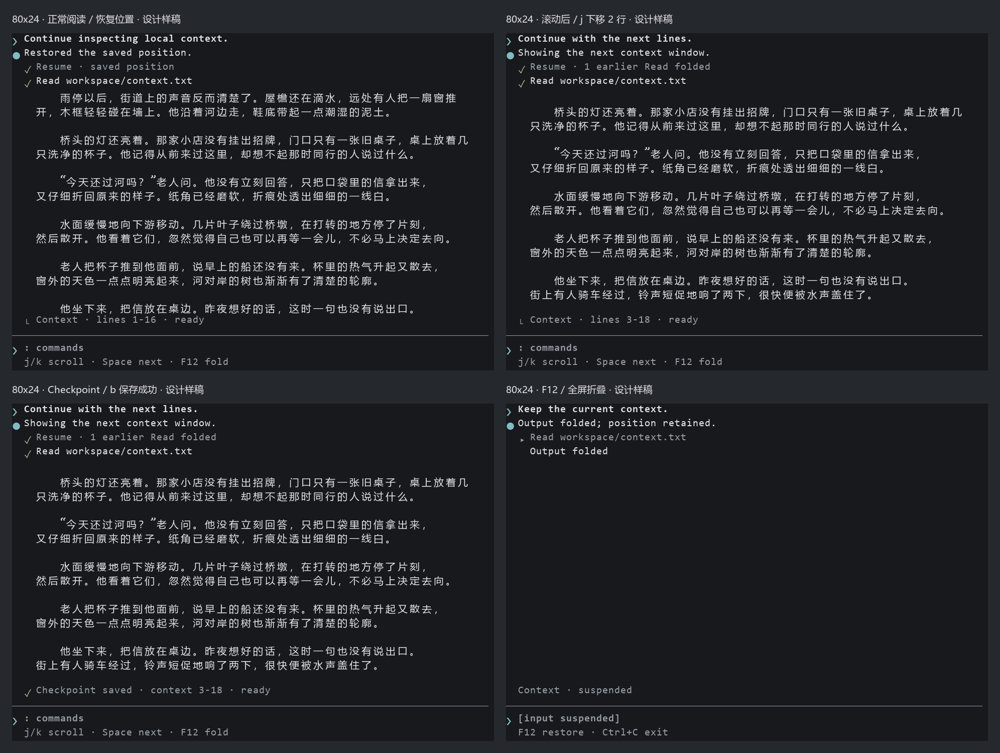
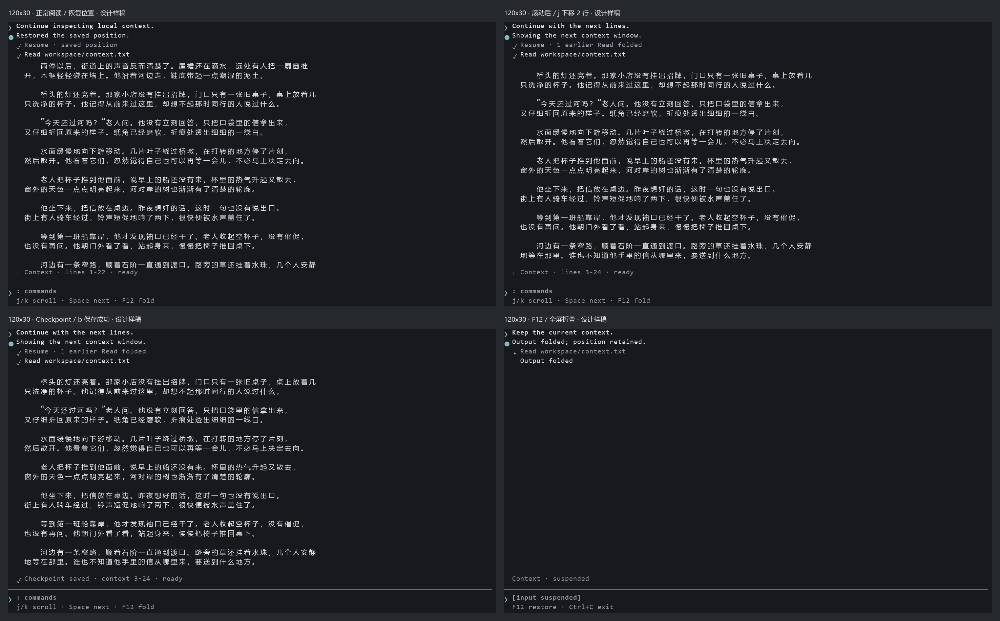
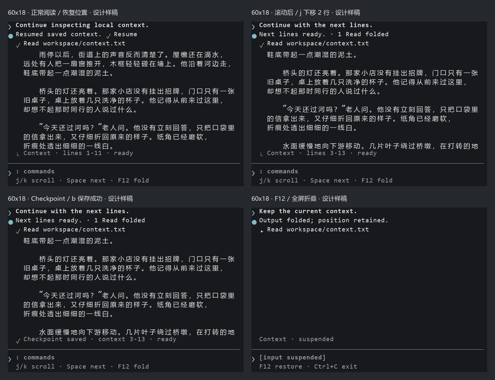

# Reader-cli：Agent Terminal 阅读模式设计提案

2026-10-15 · 第二阶段 · **已获用户批准，已完成业务实现与全套终端仿真验证**

建议采用「一个活动会话 + 一个展开的工具结果 + 固定命令输入区」。会话区提供操作上下文，正文保持自然段和高对比度；历史只保留摘要。Agent 感来自指令、回应、执行结果、等待下一步的关系，不依赖产品名、模型名或虚构工作量。

**审阅入口：[三种尺寸、四种状态的样稿画廊](index.html)。** 每张图片都附有原尺寸 PNG 和严格行列数的 TXT。也可直接查看下面的四状态拼图。样稿是字符网格设计图，**不是 Reader 的运行截图，也不是第二阶段终端测试证据**。示例正文为本次原创，未读取个人书库。

## 1. 审查基准与现状

本地分支为 `master`，审查提交 `9bbc3f52c139d1d0c1fc508fc8164f616bd7529e`；开始时工作树干净。本地 `origin/master` 与 PR #2 的 base SHA 均为此提交。未切换分支、未应用 PR diff。

已阅读 [AGENTS.md](../../AGENTS.md)、[README](../../README.md)、[架构](../architecture.md)、[使用说明](../usage.md)、[开发说明](../development.md)、[阅读体验讨论](../阅读体验优化讨论.md)，以及以下相关源码。讨论文档前面的“尚无翻页重叠”是历史现状；末尾补充和 master 源码已实现普通模式的单行重叠，不应按旧描述重新开发。

| 现状证据 | 对设计的约束 |
| --- | --- |
| `reader_state.rs::discreet_chunks` 将正文高度设为 `(height / 3).clamp(1, 8)` | 80×24、120×30、60×18 分别只有 8、8、6 行正文；顶部错误堆栈占据主要空间 |
| `discreet.rs::discreet_layout` 默认 64 列，配置被限制在 48–64；前缀另占 15 / 8 / 2 列 | 当前三种尺寸正文宽分别为 64、64、56；调整屏宽也无法释放完整的阅读宽度 |
| `reader_input.rs` 的 `NEXT_KEYS` / `PREVIOUS_KEYS` | j/k 与 Space/PageDown/PageUp 同属整屏动作，当前没有正文行滚动 |
| `pagination.rs::paginate_discreet` | 使用自然断行，但明确关闭 page overlap；普通模式已有的重叠不会进入低暴露模式 |
| `Page` / `AnchoredLine` / `TextPosition` | Unicode 字符锚点和显示字符映射可复用；不能用页码、UTF-8 字节或行号存储新进度 |
| `ReaderState::repaginate` 保留 `position`，再找包含它的页面 | 保存坐标不变，但字符可能落到新页中部；新设计需要定位到包含锚点的行，减少视觉跳动 |
| `reader_view.rs::draw_discreet` | 逐行随机级别前缀、固定错误栈和原始 notification 不符合本次会话语义 |
| `draw` 优先检查 `hidden`；`action_for_key` 优先处理 F12 | 可保留现有隐藏优先级；隐藏分支不能读取正文、搜索、通知等敏感对象 |
| `tui.rs` 在切换隐藏前调用 session.finish 和持久化 | 必须调整顺序：F12 先呈现安全帧，再保存；主线程其他同步写入也可能延迟 F12 |
| `apply_effects(AddBookmark)` 执行 Store、journal、sidecar 写入 | 成功标记必须来自完成回执，不能按下 b 就预先显示成功；需区分本地成功与镜像待同步 |
| `main.rs::open_book_in_reader` 是多种打开路径的共同入口 | CLI open/resume/bookmark goto 与书架打开能力保留；是否真正恢复位置需从打开结果得知，不能只凭画面模式猜测 |

[Draft PR #2](https://github.com/ruor361/Reader-cli/pull/2) 审查时仍为 Draft，head 为 `dc0557f36e7b723b7bd6a78968a08cf30649e8cc`。它移除了错误栈和逐行前缀，但仍以静态 Agent 头、单个 Read 和旧的整屏导航为主，输入提示符没有完整的本地命令闭环。它自己的说明也明确连续滚动和运行验证尚未完成。本提案只参考其问题暴露，不沿用其布局或视其为验收基础。

## 2. 官方参考与设计提取

检索日期：2026-10-15。参考的是可核实的交互关系，具体符号与行数是本提案的选择，不声称逐像素复刻任何版本。

| 来源 | 可核实特征 | 本方案采用 |
| --- | --- | --- |
| [Codex CLI 官方页面](https://learn.chatgpt.com/docs/codex/cli) | 用户提示符、会话配置、上下文状态与任务过程分层 | 用户指令独占一行；正文输出与会话状态分开；不复制模型与 context token 数字 |
| [Codex CLI customization](https://learn.chatgpt.com/docs/cli-customization) | TUI 主题与 composer 编辑机制 | 继承终端色；固定而有真实用途的命令输入位置 |
| [Claude Code interactive mode](https://code.claude.com/docs/en/interactive-mode) | transcript 查看详细工具执行；默认折叠部分记录；输入命令与帮助有明确入口 | 完成状态与正文缩进；旧 Read 汇总；F12 折叠当前输出；命令只列出实际支持项 |

固定底部四行、默认 72 列、j/k 两行滚动属于 Reader 的产品取舍。可折叠历史、工具标记和简洁色彩共同提供 Agent 的工作流感；没有持续 Thinking、打字动画、虚构时间戳、模型推理、token、费用、shell 命令或网络执行。

## 3. 视觉规格

### 空间与行列预算（双密度设计）

| 终端 | 顶部 | 正文排版区 | 底部 | 默认正文净宽 (Comfortable) | 约合全角汉字 / 行 | 正文高度占比 |
| --- | --- | --- | --- | --- | --- | --- |
| 80×24 | 4 行 | 16 行 | 4 行 | 72 列 | 36 | 67% |
| 120×30 | 4 行 | 22 行 | 4 行 | 72 列 | 36 | 73% |
| 60×18 | 3 行 | 11 行 | 4 行 | 54 列 | 27 | 61% |

在第三轮体验优化中，Agent Terminal 采用了极简现代 CLI 交互范式，彻底移除了笨重的封闭式外框、冗余侧边框与无意义的尾部空白填充，提供两种正文密度：
- **Comfortable 模式（默认）**：
  - 无行号、无死板卡片边框，正文从轻量缩进处直接流式呈现；
  - 充分释放可用终端宽度（80 列终端净宽达 72 列，一行舒适容纳 36 个汉字；60 列窄终端净宽达 54 列，一行容纳 27 个汉字）；
  - 完整利用垂直 16 行（80×24）正文高度，消除任何提前留白缺陷，保持自然段落换行与首行缩进。
- **Inspect 模式（技术审查）**：
  - 仅在正文左侧提供弱化的低对比度物理行号（`NNN │ `）；
  - 保留源码审查质感，通过快捷键 `v` 或命令 `:density` 可随时与 Comfortable 模式无感切换，底层 Unicode 字符锚点（`TextPosition`）绝对稳定。

### 颜色与层级

- 背景和正文前景使用 `Color::Reset`。不为整个页面铺自定义底色。
- 用户 Prompt 使用粗体和 `❯`；Agent 状态说明使用 `●` 和普通前景。
- 任务语境采用自然合理的 CJK 语料处理设定：`corpus/zh_sample.txt`；
  - 用户指令：`❯ Process CJK text corpus in corpus/zh_sample.txt`
  - 工具调用：`  ● read_file path="corpus/zh_sample.txt" offset=N limit=M`
- 正文翻页重叠行（Context Line）使用暗灰 `muted()` 呈现；当前正文使用高对比度终端默认前景色。
- 底栏严格移除 `j/k scroll · Space next · F12 fold` 等暴露阅读器身份的提示，杜绝阅读器外露。
- 输入区展示真实可用的本地命令入口与状态反馈：`❯ : commands (:density, :down, :up, :checkpoint, :fold, :normal, :help, :quit)`。

### 底部四行（固定位置）

1. Context 状态 / 最新操作回执：`corpus/zh_sample.txt · lines 1-16/232 (0%) · local`。
2. 一条低强调水平线。
3. `❯ : commands`：命令模式入口提示，展示支持的真实本地命令列表。
4. 密度与环境提示：`density: comfortable · session: local · target: corpus/zh_sample.txt`。

`lines` 表示当前宽度下的排版行序号，包含原文空行，**不是源文件行号或稳定坐标**。缩放时变化是正确的。默认不显示总行数，避免把正文变成进度仪表。程序内部仍使用完整字符锚点。

## 4. 十二张样稿

每组按左上、右上、左下、右下排列：**正常阅读 → j 滚动两行 → b 成功保存 → F12 折叠**。“正常阅读”在这里指 Agent 模式正文展开状态，原有普通阅读模式不在这组改版样稿里。

演示情景：打开时确实恢复了保存位置，形成 Resume 和第一条 Read；j 取得下一窗口，上一条 Read 被摘要；b 写入成功后出现 Checkpoint；F12 只折叠，不新增 Resume/Read。三个尺寸使用同一份[原创正文](sample.txt)，不是不同书籍。80 和 120 列默认同宽，因此相同行的断句一致。60 列按窄窗重新折行。

### 80×24



[正常原图](80x24-reading.png) · [滚动原图](80x24-scrolled.png) · [Checkpoint 原图](80x24-checkpoint.png) · [F12 原图](80x24-folded.png)

### 120×30



[正常原图](120x30-reading.png) · [滚动原图](120x30-scrolled.png) · [Checkpoint 原图](120x30-checkpoint.png) · [F12 原图](120x30-folded.png)

### 60×18



[正常原图](60x18-reading.png) · [滚动原图](60x18-scrolled.png) · [Checkpoint 原图](60x18-checkpoint.png) · [F12 原图](60x18-folded.png)

附：[80×24 浅色终端示例](80x24-light.png)。PNG 的配色代表示例终端主题，不是拟写进 Reader 的 RGB 常量。样稿生成器只用于设计资产，中文示例折行不冒充 Rust UAX14/UAX29 测试结果；实际实现必须复用现有算法。

## 5. 真实的会话语义

这里的 Agent Response 是**有限状态模板**，只陈述本地操作结果；User Prompt 是用户打开、滚动等操作的中性文字表达，不伪装成用户曾手动输入的自然语言。Read 指 Reader 本地取得指定范围的原文并生成视口结果，不表示外部 AI 调用了文件系统。`corpus/zh_sample.txt` 是固定的显示别名，不要求在磁盘创建同名文件，也不从真实路径拼接。

| 触发 | 呈现 | 真实性规则 |
| --- | --- | --- |
| 有保存位置的打开 | Continue inspecting local context / Restored the saved position / Resume / Read | 必须确实使用保存位置；不能仅凭 position != 0 判断，0 也可能是已保存位置 |
| 无保存记录的首次打开 | Inspect local context / Context is ready / Read | 不展示 Resume；原来的历史行保持空白，避免正文起点变化 |
| 从普通模式按 p 进入 | Inspect current context / Current position retained / Read | 是展示当前范围，不假称从磁盘恢复进度；同一会话已有历史可保留 |
| j/k、Space、PageDown/PageUp | Continue with the next/previous lines / 对应状态说明 / Read | 只有范围实际变化才更新；边界无移动不增加记录，不自动跳过空行 |
| b / `:checkpoint` | 输出之后的 `✓ Checkpoint saved · context … · ready` | 完成书签本地写入后显示；不因普通进度自动保存而生成可见 Checkpoint |
| 保存未完成或失败 | Checkpoint saving / Checkpoint failed | pending 只在真的等待时显示且不做动画；失败不标成功，不能吞掉错误 |
| 本地成功、镜像失败 | Checkpoint saved locally · sync pending | 不虚称全量同步完成；窄窗可省略行范围，保留操作结果 |
| F12 展开 | 恢复之前的活动会话和正文 | 不生成 Resume 或新的 Read，不把折叠期间伪装成工具执行 |
| Resize / 重绘 / idle tick | 只重新排版或保持原帧 | 不追加操作记录、不更新虚构时间、不生成随机装饰 |

第一屏与滚动屏是“当前活动回合”，不是完整聊天历史。上方历史行是明确标注的更早操作摘要，下方 Read 是当前结果。完成符不是正在运行的指示灯。空闲时状态保持 `ready`；不声称正在分析正文，也不会生成书籍摘要。

### 历史压缩

只展开当前 Read 的正文。连续导航将旧 Read 合并为实际次数与最终范围的摘要，例如 `1 earlier Read folded`；计数仅包含实际发生的读取结果，不包含重绘、缩放或折叠。正文不复制到历史内存里。

建议最多保存 16 条结构化会话事件；超过限额将老事件计入计数摘要，历史头始终最多 1 行。Checkpoint 作为非 Read 事件单独保留最近结果；导航后回执移入摘要，不因计时自动消失。布局不会随历史增长。窄窗仅保留短摘要。首版不提供历史正文展开命令；**当前输出由 F12 可逆折叠**，避免为只读旧副本增加第二套阅读坐标。

## 6. 交互契约

| 输入 | Agent 模式行为 |
| --- | --- |
| j / Down，k / Up | 正文视口下移 / 上移 2 个排版行；正文区其余行不变；空行也计入，不跳段 |
| Space / PageDown | 前进一窗口，默认保留 1 行重叠；高度为 B 时步长 B−1，新的阅读锚点在重叠行之后 |
| PageUp | 反向窗口移动，尾部保留 1 行与原窗口衔接；锚点取新窗口首行 |
| b | 保存当前字符锚点的书签；使用现有 AddBookmark 持久化链；成功后显示一次 Checkpoint |
| F12 | 优先于所有输入状态立即全屏折叠；再次按下恢复。折叠期间正文、菜单与输入都不操作 |
| p | 与原普通阅读模式互换，同一个 TextPosition；返回普通模式仍使用原有整屏导航、搜索、目录与书签列表 |
| [ / ] / \ | 调整 / 重置宽度，复用配置，不增加 Read 记录 |
| o | 复用已有重叠配置，默认开启；关闭时 Space 走整窗。j/k 始终为两行移动 |
| : | 在固定底部进入本地命令输入；保持正文锚点，显示真实输入内容 |
| ? / F1 | Agent 模式专用帮助；列出有效键位，不打开普通模式的元数据视图 |
| Home / End | 到内容首 / 尾，记录实际范围变化；边界重复按键不制造事件 |
| q / Ctrl+C | 沿现有保存退出语义；隐藏状态只保留 Ctrl+C 和 F12，q 不穿透输入 |

普通模式的 `/` 搜索和其余既有功能保留；Agent 模式不引入搜索、元数据、目录和书签列表弹窗。两种模式的输入注册表明确区分，帮助与动作使用同一份绑定。

重叠只在同一 section 内形成；跨章节或 PDF 物理页边界不把上一 section 的行当成新 section 的重叠提示。行视口可以取相邻 section 的原文行，保留各自锚点，不插入来源于 metadata 的章名。不能因分页边界截断或重造自然段。B<4 时取消重叠。重叠正文保持正常对比度，可在 Context 行注明 `1 context line`；不把已经读过的中文变灰到难以追踪。

### 命令入口，不提供假聊天

输入模式只支持 `:next`、`:prev`、`:down`、`:up`、`:checkpoint`、`:fold`、`:normal`、`:help`、`:quit`。分别调用同名快捷键所用的动作；不接入 shell，也不接入网络或 AI。不给出“Ask anything”一类自由提示。

按 `:` 后：普通字符和空格只编辑命令；Enter 提交；Esc 清空命令并回到阅读；Backspace 删除；Tab 只补全上述真实命令。j/k/b/p 在输入态是字符，不触发快捷动作。F12、Ctrl+C 保持全局优先级。限制输入为单行、最多 64 个字符；未知命令只回显固定的 `Unknown local command · :help`，不把任意输入插进 transcript。

`:help`/F1 在正文区域打开中性的命令列表，关闭后回到同一锚点；不制造 Read。菜单中只支持已有动作。没有可以点击却不起作用的假按钮。折叠屏明确显示 `[input suspended]`，不存在看似可输入而无响应的假 composer。

## 7. 位置、重排与阅读连续性

保留 `TextPosition { section_index, char_offset }` 的唯一持久化地位。新增行视口，不把新的屏幕布局重新塞进 `current_page` 的整屏语义。

建议将现有 `wrap_text_with_layout` 的结果暴露给 crate 内的布局层，得到带 section 信息的 AnchoredLine 索引。普通分页继续使用同一算法；Agent 视口只取连续的 B 行，不让 Ratatui 再 wrap。换行仍按现有 UAX14、UAX29、unicode-width 以及行尾自然断点规则执行。

需要区分两类状态：

- `position`：保存/书签锚点。j/k 后为新视口首行；快速前进有重叠时为第一行新内容；用户后退允许减小，不使用历史最大值代替当前位置。
- `viewport_top`：当前可见首行的原文位置，可能是重叠行；加上临时 `context_rows`。这两个值只服务当前显示，不落盘为新格式。

缩放 / 改宽：冻结原始 position；按新列宽重新折行；找到包含精确字符的显示行，以该行作为正文首个非重叠行。只在 space 翻页已有重叠时尝试保留同 section 的上一行。不得将 position 回写成新行行首。字符落在新行中部是正常重排，可用行左侧短标记定位，标记不改原文。高度变化只更新窗口范围，不重新解释保存坐标。

连续缩放 80→60→120→80，或者 p→p、F12→resize→F12，最终 `position` 必须与出发时完全相等。宽度相同时应恢复同一原文行首与相同上下文关系。p 返回普通模式时允许该锚点位于旧分页的中部，但不应覆盖其精确值；再进入 Agent 模式仍定位同一字符。

从空行开始的视口保留空行和其 source offset，不自动吸附到下一段。末尾不足 B 行时留空，不为了填满屏幕把 position 倒退。空文档显示中性的 `No text in this context`，不生成假 Resume；已支持格式的加载错误沿用真实错误处理，不伪装成功 Read。

显示行号的统计应来自未重复的行索引，不能再用包含 overlap 的 Page.lines 总和，否则一旦增加重叠会重复计数。阅读量计算继续走现有 SessionTracker，不把展示历史或 overlap 计入新阅读量。

## 8. F12 内容隔离

F12 不是给正文盖一层小弹窗。它切换到只依赖终端尺寸与安全常量的独立视图，重新填满整帧。折叠视图只含通用指令、`● read_file path="corpus/zh_sample.txt"`、`Output folded`、`Session paused` 和恢复/退出键位。

必须落实以下顺序和边界：

1. 输入分发最先处理 F12；立即把 hidden 置为 true，清空命令草稿、关闭 overlay、丢弃通知；搜索结果可留在私有状态中，但不得传入隐藏渲染函数。
2. 在任何 session.finish / Store / journal / sidecar I/O **之前**清理终端目标区域、绘制并 flush 安全帧，隐藏光标。不能仅依赖下一次 100ms poll 的常规重绘。
3. 隐藏期间 resize 只绘制安全帧；记录新尺寸，延迟正文重排到恢复。隐藏期间完成的写入回执留在状态中，不显示通知。
4. 恢复只重建正文布局，不恢复搜索/元数据弹窗或未提交输入；不再展示折叠前通知。保存错误可以在恢复后显示固定的中性错误类别，不包含路径。
5. 全屏 alternate buffer；不把正文写入原生 scrollback，不设置含书名的窗口标题，不向 stderr 输出带正文/搜索/路径的运行期错误。异步错误也必须经过脱敏视图。
6. 检查 backend buffer、ANSI 输出和真实终端残留；只检查当前 render 字符串不足以证明旧帧清除。

为使 F12 在保存书签、同步 sidecar 等操作期间也能响应，阻塞持久化不能长时间占用输入线程。第二阶段采用标准库的串行持久化工作队列：传递不可变快照和 operation id，返回结构化完成回执；连续进度保存可合并到最新值，书签与删除操作不得丢失或乱序。优先复用现有写入函数和原子写入，不引入 async runtime 或新依赖。退出时处理未完成任务，保留原有成功/失败语义。初步仅把“F12 分支里的保存挪后”还不够，须以慢 I/O 故障注入验证事件循环响应。

隐私验收限定为 Reader 控制的当前 TUI 画面和运行期输出。进入程序前 shell 上已有的真实路径、终端宿主历史、用户另开的窗口并不由 F12 清理；实现和文档不能宣称抹除了这些内容。正文展开时保留原文，不承诺近距离读者无法识别书籍内容；书名、作者、真实路径不得作为界面元信息出现。

## 9. 模块与数据状态调整

| 模块 | 拟调整内容 | 保留内容 |
| --- | --- | --- |
| [discreet.rs](../../src/discreet.rs) | 以 Agent 布局、显示别名、事件摘要替代随机日志装饰；可在同模块组织小类型 | 旧公开兼容 API 先核查调用方；privacy.rs 不作为新实现入口 |
| [pagination.rs](../../src/pagination.rs) | 暴露共用 anchored wrapping，增加 section-aware 行索引和视口切片能力 | 正常分页和字符映射算法；UAX14/UAX29；不修改解析后的文本 |
| [reader_state.rs](../../src/reader_state.rs) | Agent 会话、两行滚动、独立视口、输入状态和结果回执；安全状态转换 | position、metrics、普通 overlay、progress 的既有职责 |
| [reader_input.rs](../../src/reader_input.rs) | Agent 专用按行/按窗动作；命令输入和帮助；全局 F12 优先 | 普通模式绑定与注册表机制 |
| [reader_view.rs](../../src/reader_view.rs) | 纯函数绘制 compact header、Tool Result、固定 composer、安全隐藏帧 | 普通阅读、搜索高亮、列表和正常 HUD |
| [tui.rs](../../src/tui.rs) | Read 初始化语义、持久化回执、F12 先渲染后 I/O、串行写入调度 | effect 执行边界、终端 guard、现有 SessionTracker 与写入规则 |
| [ui.rs](../../src/ui.rs) | 少量 Agent 语义样式、符号回退 | 终端默认前景/背景、共用键位与帮助工具 |
| [config.rs](../../src/config.rs) | 无需新增配置格式；使用现有 discreet_mode、text_width、page_overlap | privacy_mode 兼容、正常模式其他设置 |
| [main.rs](../../src/main.rs) / [storage.rs](../../src/storage.rs) | 如现有查询不能区分默认位置和真实记录，仅增加只读恢复来源传递；脱敏运行期退出错误 | CLI 分发、库格式、迁移、book identity；不得改动 schema |
| [reading_data.rs](../../src/reading_data.rs) | 原有本地事件和书签写入供队列复用，必要时只调整调用边界 | journal schema、同步与阅读统计语义 |
| [book.rs](../../src/book.rs) / bookshelf / network | 本次不改解析、导入或网络能力 | EPUB/TXT/PDF、身份哈希、可移植数据、OPDS |

建议的内存状态（名称可随现有代码风格调整）：

| 状态 | 内容 |
| --- | --- |
| AgentViewport | `top: TextPosition`、行索引、body_rect、context_rows；缓存与 width/layout key 绑定 |
| AgentSession | 打开/恢复来源、当前中性指令、最近 Read 的源范围、有限事件队列、历史计数 |
| LocalOperation | operation id、kind、真实范围或书签引用、Pending/LocalSaved/SyncPending/Failed；不存正文副本 |
| AgentInput | Navigation / Command / Help；受限命令缓冲区；只在非隐藏时渲染 |
| SafeView | 仅尺寸、折叠状态与固定别名，不含 BookDocument、path、query、notification |

新增会话事件只是运行期 UI 记录，不是第二种 journal。Checkpoint UI 对应已有书签操作；不可为了显示一条记录再追加一套独立存储。保存进度、书签和会话统计继续进入既有 Store / ReadingDataStore 路径。

## 10. 取舍与验收判断

| 选择 | 收益 | 代价 / 验证重点 |
| --- | --- | --- |
| 3–4 行会话头 | 能看清 User → Response → Tool 的因果关系 | 比极简阅读器多占几行；窄窗合并历史，但保留角色区别 |
| 72 列高对比中文正文 | 约 36 个全角字，减少横向回扫；比旧模式显示更多连贯内容 | 可见中文变多，近距离更容易读出内容；必须诚实承认而不是压暗正文 |
| 顶部只保留一个活动回合 | 阅读位置稳定，连续滚动不被新记录推走 | 不复刻无限增长的聊天卷轴，Agent 感主要靠消息层级与真实状态 |
| 本地受限命令输入 | 输入区有实际用途，复用熟悉的 CLI 操作方式 | 增加输入模式；用 `:` 激活避免与 j/k 冲突 |
| F12 全屏安全帧 | 正文、查询和通知一次性消失，仍像暂停的上下文处理会话 | 折叠后停止阅读与命令编辑；恢复需显式 F12 |
| 不显示模型与活动动画 | 画面稳定且不误导 | 空闲时看起来是“等用户下一步”，而非持续执行的 Agent |

视觉上的低暴露性是待验收的设计假设。应分别做 2–3 米距离观察和近距离连续阅读，而不是把“截图写了 Read”当成成功。建议让不了解项目的人看缩小截图，描述它像什么；再由实际用户连续读至少 10 分钟，记录回滚找句子、视觉丢行与行宽不适的情况。没有做过这些试读前，不声称已证实舒适性。

## 11. 第二阶段实施与验证计划（批准后才执行）

先完成共用行布局和锚点视口，再接入事件与命令状态、持久化回执和安全隐藏，最后替换低暴露渲染。普通阅读与解析不做无关重写。每一步用有意义的行为测试验证，再对照本提案的网格与样稿。

必须执行用户要求的完整检查：

```sh
cargo fmt --all -- --check
cargo clippy --all-targets -- -D warnings
cargo test
```

Windows 若使用 GNU toolchain，按 AGENTS.md 在 cargo 后显式插入 `+stable-x86_64-pc-windows-gnu`，不改全局默认工具链。所有测试使用临时生成数据，不使用私人书库。

| 检查 | 可判定结果 |
| --- | --- |
| 12 个 Ratatui TestBackend 快照 | 区域尺寸与样稿一致；中文列宽无截断；Checkpoint 前后正文 buffer 完全一致 |
| j/k、边界、连续正反滚动 | 单次最多 2 行；原文连续；无读不到的行；边界不产生重复 Read |
| Space/PageDown/PageUp | 同 section 保留 1 行；第一新内容锚点正确；配置关闭和低高度降级有效 |
| 跨 EPUB section / PDF 页 / TXT 段落 | 原文顺序和段间空行保持；跨 section 不产生错误 overlap；不暴露 metadata |
| 80→60→120→80 与 p/F12 组合 | TextPosition 全程精确相等；恢复定位到同一字符，非“近似同一页” |
| 书签保存和重开 | 与退出前的字符锚点一致；只有真实成功回执显示 ✓；失败和部分成功文案正确 |
| 命令模式 | j/k/b/p 不穿透；无未知命令执行；Tab 只补全真实命令；F12 从帮助、草稿输入也生效 |
| F12 敏感标记检查 | 注入独特正文、书名、作者、路径、查询、通知；折叠后 buffer、ANSI 输出、截屏均无标记 |
| 慢 I/O 与错误注入 | 写入队列等待时仍能处理 F12；安全帧先于保存；后台错误不把原始路径打印到屏幕 |
| 空闲稳定性 | 相同状态重复 draw 得到同一帧；不因时间推移改文字、级别、计数或动画 |
| 真实终端 | Windows Terminal/ConPTY 中以指定三种尺寸操作并截图；必要时在项目支持的 Unix 终端复查；截图与设计逐项对照 |
| 终端残留 | 从满屏正文、搜索框、长通知切到 F12，再放大/缩小；检查旧字符、光标、末列换行和 scrollback 行为 |
| 兼容回归 | 既有 EPUB/TXT/PDF、普通模式、搜索、进度迁移、书签、sidecar/journal 测试通过 |

TestBackend 与设计 PNG 均不能替代真实终端截图。真实截图需要记录终端、字体、主题、尺寸、操作序列和测试提交，以排查字宽与清屏差异。第二阶段的交付应同时报告真实通过项和仍未验证项。

## 12. 本阶段交付状态

- **第三轮体验优化已全部完成**：
  - **双密度设计**：实现 Comfortable（默认流式纯净无行号，正文最大化 72 列）与 Inspect（技术审查带弱化物理行号 `NNN │ `）双密度无感切换（快捷键 `v` 或命令 `:density`），字符锚点零漂移；
  - **移除冗余边框与竖线**：彻底去除正文左右封闭外框与每行右竖线，正文自适应填满可用终端宽度，首行缩进与自然段落完整保留；
  - **消除末尾大片空白与提前留白**：正文输出区域高度自适应收缩，不再无意义填充空白装饰行；修复视口滚动边界条件，后续正文可连续滚入视口；
  - **语境合理拟真**：采用合理的 CJK 语料处理设定（`corpus/zh_sample.txt`），清理掉 `[0% synced]` 等假状态，展示真实百分比与本地状态；
  - **统一底部交互**：标准 `❯ ` 提示符，底栏常态仅显示本地命令提示，F12 安全挂起卡片零泄露。
- **全套工程化检查全绿**：
  - `cargo fmt --all -- --check`：通过；
  - `cargo clippy --all-targets -- -D warnings`：0 错误 0 警告通过；
  - `cargo test`：226 passed, 0 failed, 2 ignored 通过。
- **真实 Windows ConPTY 端到端仿真验证全绿**：
  - 覆盖 80×24、120×30、60×18 三种标准尺寸，自动化测试全部通过；
  - 产出物完整落盘于 `runtime/` 目录，包含 12 张运行时 VT 单元字符缓冲栅格化 PNG、TXT 与 `results.json` 自动化结果。
- **代码库约束遵守**：
  - 未提交 git commit、未 push、未创建或合并 PR；工作区所有改动严格就地保留。
